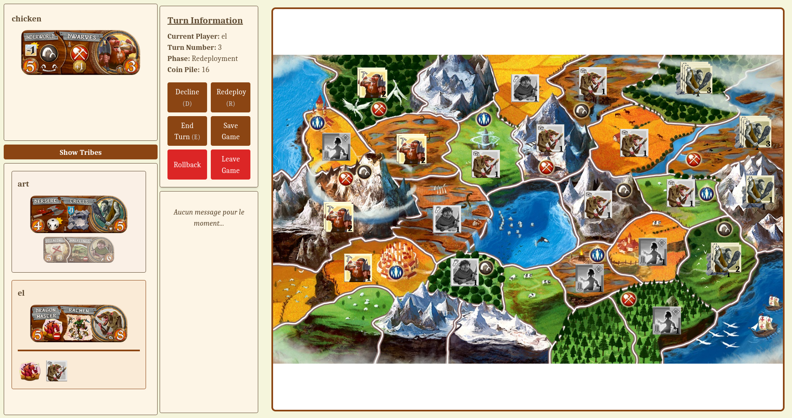
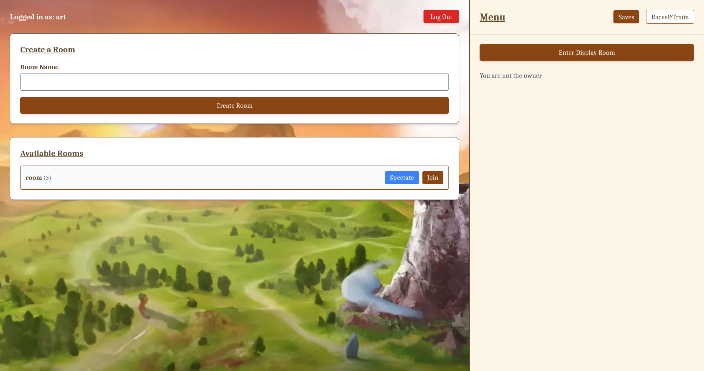
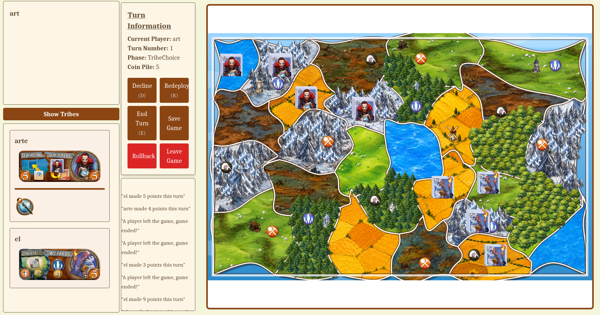

# Smallworld

Smallworld is a browser-based implementation of the board game. The complete
stack contains a React frontend, a Go WebSocket gateway, two Go room workers,
the map generator, PostgreSQL, Redis, and nginx.

## Deploy on any Linux server with Docker

This is the shortest route when the server is not running NixOS. Install Git,
Docker Engine, and the Docker Compose plugin, then run:

```console
git clone --recurse-submodules https://github.com/Arthur158/smallworld.git
cd smallworld
cp .env.example .env
```

Set a real database password in `.env`. A safe hexadecimal password can be
generated with:

```console
openssl rand -hex 32
```

Launch the complete backend2 stack:

```console
docker compose -f docker-compose.production.yml up --build -d
docker compose -f docker-compose.production.yml ps
docker compose -f docker-compose.production.yml logs -f
```

Open `http://SERVER_IP:3000/` from any phone, tablet, or computer that can reach
the server. Allow inbound TCP port 3000 in the server and cloud firewalls. Only
the frontend is published; PostgreSQL, Redis, gateway, workers, and the map
generator remain on the private Compose network.

To update or stop it:

```console
git pull --recurse-submodules
docker compose -f docker-compose.production.yml up --build -d
docker compose -f docker-compose.production.yml down
```

The named PostgreSQL and Redis volumes survive `down`. Do not use `down -v`
unless you intentionally want to delete saved data.

The root `docker-compose.yml` is the older single-backend development stack;
use `docker-compose.production.yml` for the complete backend2 deployment.

## Check the NixOS configuration without running NixOS

Any Linux machine with Nix can evaluate and build the complete NixOS system
closure. You do not need `nixos-rebuild`, and the command neither boots a VM
nor changes the host operating system:

```console
git submodule update --init --recursive

nix --extra-experimental-features 'nix-command flakes' \
  flake check . --show-trace

nix --extra-experimental-features 'nix-command flakes' \
  build .#checks.x86_64-linux.module --no-link
```

This proves the module evaluates and that the complete NixOS system closure,
including all Smallworld packages and service units, can be built. Runtime
readiness is checked after deployment with the commands below.

Individual packages can also be built on any Linux host with Nix:

```console
nix --extra-experimental-features build .#backend
nix --extra-experimental-features build .#frontend
nix --extra-experimental-features build .#map-generator
```

## Deploy on a real NixOS server

Add this repository to the target machine's system flake:

```nix
{
  inputs.smallworld.url = "github:Arthur158/smallworld";

  outputs = { nixpkgs, smallworld, ... }@inputs: {
    nixosConfigurations.game-server = nixpkgs.lib.nixosSystem {
      system = "x86_64-linux";
      specialArgs = { inherit inputs; };
      modules = [
        ./configuration.nix
        smallworld.nixosModules.default
        { services.smallworld.enable = true; }
      ];
    };
  };
}
```

On the NixOS server, test before making the deployment persistent:

```console
sudo nixos-rebuild test --flake /path/to/nixos-config#game-server
sudo nixos-rebuild switch --flake /path/to/nixos-config#game-server
```

It is expected that `nixos-rebuild` is absent on Ubuntu, Fedora, and other
non-NixOS hosts. Such a host can deploy to a NixOS server over SSH through Nix:

```console
nix run nixpkgs#nixos-rebuild -- \
  test --flake /path/to/nixos-config#game-server \
  --target-host root@SERVER_IP
```

See [`nix/README.md`](nix/README.md) for HTTPS/ACME, external databases,
secrets, module options, and operational commands.

## Verify a running deployment

For Docker Compose:

```console
docker compose -f docker-compose.production.yml ps
curl --fail http://127.0.0.1:3000/
```

For NixOS:

```console
systemctl status smallworld-gateway smallworld-worker-0 smallworld-worker-1
curl --fail http://127.0.0.1:8080/readyz
curl --fail http://127.0.0.1:8100/readyz
curl --fail http://127.0.0.1:8101/readyz
curl --fail http://127.0.0.1:3001/api/health
curl --fail http://127.0.0.1:3000/
```

## Development

- `backend2/k8s-local/` contains the multi-service kind deployment.
- `nix develop` opens a shell with Go, Node.js, PostgreSQL, and Redis tools.
- The map generator is a Git submodule. After changing it, commit and push the
  submodule first, then commit the updated submodule pointer in this repository.

## Screenshots

A game with three players:



Inside the lobby:



Generating random maps:


